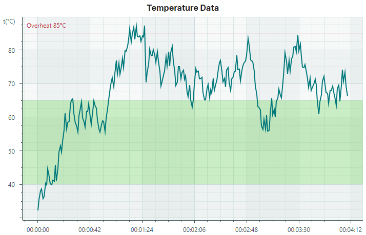
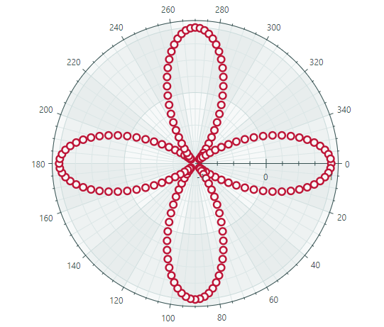
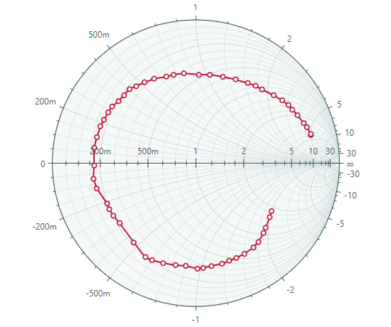

# Charts

The library includes chart controls that visualize data as 2D charts. Their rendering is optimized for large data - the controls maintain high performance even when series contain millions of points.

## CartesianChart

`CartesianChart` plots a diagram in a Cartesian coordinate system.

- An unlimited number of data series within each chart
- Multiple axes support
- Swapping and reversing the X and Y axes
- Axis types: Numeric, Date-Time, Time Span, Qualitative, and Logarithmic
- Scrolling and zooming all axes at the same time, or individual axes
- High-performance when displaying large data
- Real-time data visualization, including a special data adapter with a moving viewport
- Crosshair
- Strips and constant lines
- Advanced line customization with `LineStyle`: thickness, dash pattern, line caps and joins
- Empty points (gaps) - data points with undefined values leave visible gaps in a series
- Using the MVVM design pattern to provide data and customize chart options

Series types: Line, Scatter Line, Point (with SVG marker support), Area, Step Line, Step Area, Range Area, Stacked Area, Full-Stacked Area, Bar, Range Bar, Candlestick, and Lollipop.

See [Cartesian Chart](https://eremexcontrols.net/controls/charts/cartesian-chart/) for details.

## PolarChart

Plots a diagram in a polar coordinate system.

- Crosshair
- Strips and constant lines
- Sweep direction and start angle (for the X axis)
- MVVM support

Series types: Point, Line, Scatter Line, Area, and Range Area.

## SmithChart

Creates a Smith chart.

- Crosshair
- MVVM support

Series types: Point and Scatter Line.

## Documentation

- [Charts](https://eremexcontrols.net/controls/charts/)
