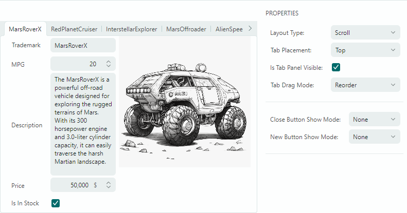

# Utility Controls

Multiple utility controls shipped with the Eremex Controls library help you create a functional and appealing UI.

- **MxTabControl** - Combines panels into a tabbed UI.
    - An unlimited number of tabs
    - Populating tabs and tab contents from an items source
    - Tab re-ordering via drag-and-drop
    - Tab layout modes: stretch, scroll, and multi-line
    - Tab sizing modes and icon display modes
    - 'Close tab' buttons and a 'New Tab' button
    - Custom controls in the tab header area

- **MxSplitButton** - Combines two buttons in one control: the primary button executes the main action, the secondary button opens an associated dropdown menu or a popup control.

- **SplitContainerControl** - Separates two panels with a splitter.
    - Dragging the splitter changes the size of the panels
    - Vertical or horizontal arrangement
    - Collapsing and expanding one of the panels
    - An option to hide the splitter

- **ColorEditor** - A standalone control that allows a user to pick a color.
    - Three color palettes - Default, Standard, and Custom
    - The Custom palette lets users add and modify colors with the built-in color picker
    - Colors can be specified in RGB and HSB formats

- **CalendarControl** - A standalone control that allows a user to pick a date.
    - Date selection with the mouse and keyboard
    - Navigation bar to browse through months and years
    - Month, year, and year range views
    - An option to limit the available date range

- **GroupBox** - A panel with a header that displays custom text.

- **CircleProgressIndicator** - Displays the progress of an operation as a rotating circle.

- **MxWindow** - A window that paints its title bar and borders with the Eremex visual themes, with options to customize the visibility and glyphs of the standard buttons.

- **MxMessageBox** - Displays a message box as a modal window with a text message, an icon, and a set of standard buttons.

## Documentation

- [Utility Controls](https://eremexcontrols.net/controls/utility-controls/)
- [Windows and Dialogs](https://eremexcontrols.net/controls/windows-and-dialogs/)
