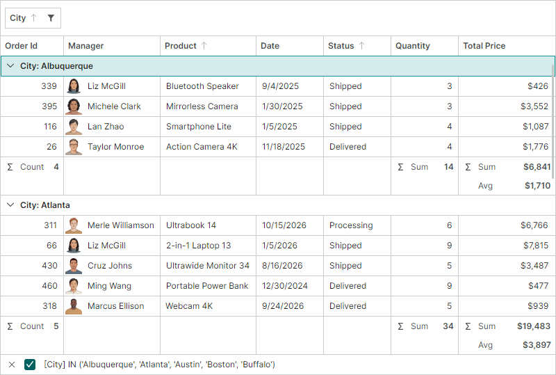

# Data Grid

`DataGridControl` allows you to display data from an items source in columns and rows. It provides rich data shaping and editing functionality: users can rearrange columns, edit, sort, group, and search data.

- **Data Binding** - Bind the control to an IList, IBindingList, DataTable, or any IEnumerable data source.
- **Data Sorting** - Sort data against an unlimited number of columns.
- **Data Grouping** - Combine rows with identical column values into data groups, against multiple columns.
- **Summaries** - Total and group summaries (aggregate functions calculated over rows). Apply summaries in code, and let users add them at runtime.
- **Filtering** - Filter data with dropdown menus that display unique column values.
- **Search Panel** - Quickly locate rows by the data they contain.
- **Auto Filter Row** - A special row that allows a user to filter data against columns.
- **Styles** - Customize the appearance of the control's elements in various states.
- **Data Edit Operations** - Embed Eremex and custom editors in cells to edit and present values.
- **Data Validation** - Check a user's input and data source values, and show errors in cells.
- **Built-in and Custom Context Menus**
- **Unbound Columns** - Add columns that are not bound to data source fields and populate them manually.
- **Column Resize and Move Operations**
- **Row Drag-and-Drop** - Drag a row within the control and to another control.
- **Column Bands** - Visually group multiple columns under a common header.
- **Fixed Columns** - Keep specific columns visible at the left or right edge while other columns scroll horizontally.
- **Best Fit** - Resize columns to the minimum width required to display their contents without truncation.
- **Column Header Templates** - Display custom content in column headers, including images.
- **Multiple Row Selection** - Select (highlight) multiple rows at once.
- **Data Annotation Attribute Support** - Control visibility, position, read-only state, and display name for auto-generated columns.
- **High Performance for Large Volumes of Data** - Vertical and horizontal data virtualization.
- **Export to XLSX, PDF, CSV and Image Formats**

## Documentation

- [Data Grid](https://eremexcontrols.net/controls/datagrid/)
