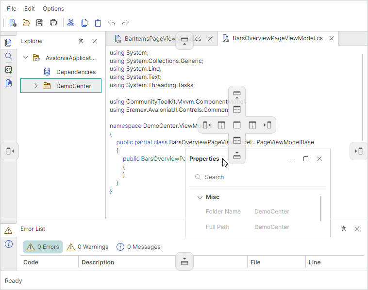

# Docking UI

The `DockManager` component allows you to implement the classic docking UI found in popular IDEs. Create tool panels that support dock, auto-hide, and float operations, use special Document containers to display the main content of a window, and organize multiple Documents into a tabbed UI.

- Visual Studio IDE-inspired UI
- Dockable tool panels and floating panels
- Panel auto-hide functionality
- Documents - special containers used to display the main content of a window
- Tabbed UI
- Document Switcher
- Runtime layout customization
- Customizable dock guides - hide specific dock guides and individual guide items at runtime
- Native Wayland support on Linux - the **Dock To** command in the context menu, and **Float** to make a docked panel floating
- Built-in context commands
- MVVM support
- Serialization and deserialization of the panel layout

## Documentation

- [Docking UI](https://eremexcontrols.net/controls/docking/)
