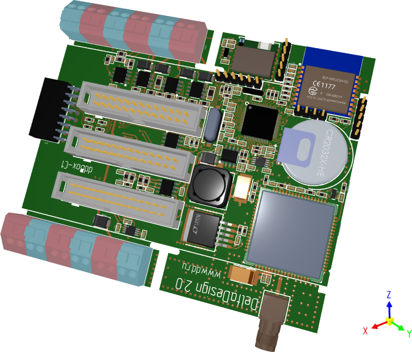

# Graphics3DControl

`Graphics3DControl` allows you to display one or more interactive 3D models in a window of an Avalonia UI application. The control's rendering engine is powered by the Vulkan API v1.1.

Users can rotate, pan, and zoom models with the mouse and keyboard. To specify 3D models, use the control's API - classes and members to define vertices, meshes, materials in PBR format, camera settings, and model transformations.

- Built on Vulkan SDK 1.1, GPU accelerated rendering
- Own API to specify 3D models
- Simple materials and textured materials in PBR format
- Displaying multiple 3D models simultaneously
- Perspective and isometric camera modes
- Model rotation, panning, and zooming with the mouse and keyboard at runtime
- Selection and highlight of model elements
- Displaying hints for model elements
- Model transformations
- Grid plane visibility (XY, XZ, and YZ planes)
- Camera rotation modes - around the camera target or around the point under the mouse pointer
- Hit testing and selectable elements
- MVVM pattern support for specifying 3D models

> **Note**: Starting with v1.3, you must register the `Controls3D` paint theme in the _App.xaml_ file to use `Graphics3DControl` - otherwise the control appears blank. On macOS, install the [MoltenVK](https://github.com/KhronosGroup/MoltenVK) runtime: standard macOS graphics drivers do not support Vulkan.

## Documentation

- [Graphics 3D Control](https://eremexcontrols.net/controls/graphics3dcontrol/)
