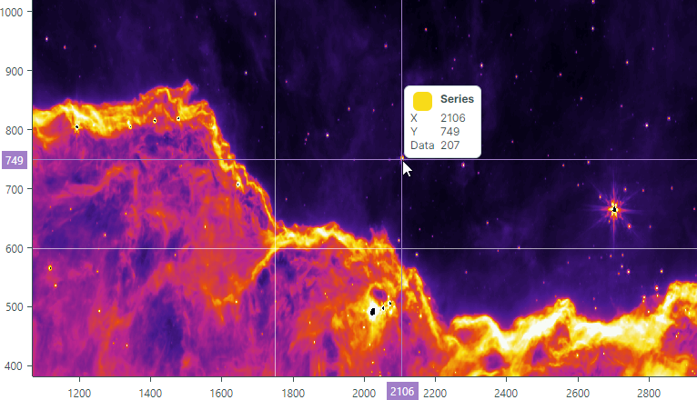
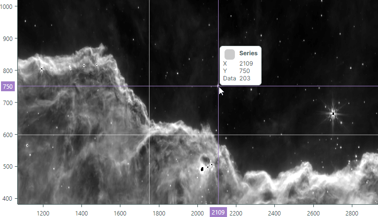

# Heatmap

The `HeatmapControl` allows you to create a two-dimensional [heat map](https://en.wikipedia.org/wiki/Heat_map) - a chart that visualizes data using color. Each data point within a 2D map is painted with a color that corresponds to a value at this point.

- Custom color encoding
- Grayscale colorization
- Customization of the X and Y axes
- Crosshair
- Strips and constant lines
- Scroll and zoom with the mouse and keyboard
- Export the result of data colorization to a bitmap

## Documentation

- [Heatmap](https://eremexcontrols.net/controls/charts/heatmap/)
