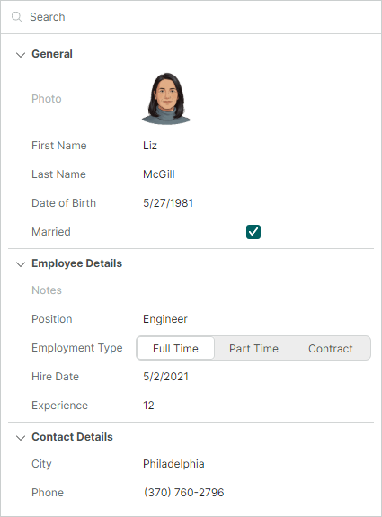

# Property Grid

`PropertyGridControl` allows a user to browse properties of a single or multiple objects. The control displays public properties and their values as a vertical list and allows a user to edit the property values.

- **Automatic Creation of Rows** - Generate rows from the information provided by the bound object(s).
- **Manual Row Creation** - Create rows for a specific set of object properties.
- **Data Edit Operations** - Embed Eremex and custom editors in cells to edit and present values.
- **Data Annotation Attribute Support** - Control visibility, read-only state, display name, category, and type converter for auto-generated rows.
- **Category Rows** - Combine rows into expandable groups.
- **Tab Rows** - Combine rows into a tabbed UI.
- **Search Panel** - Quickly locate rows by their names.

## Documentation

- [Property Grid](https://eremexcontrols.net/controls/propertygrid/)
