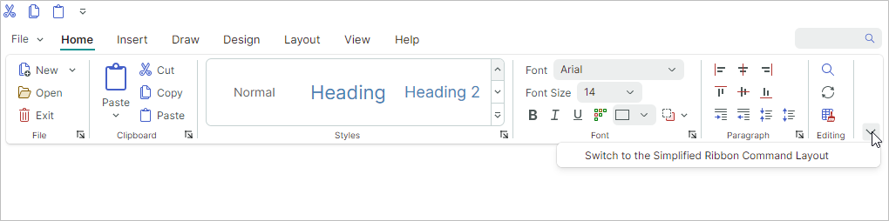

# Ribbon

`RibbonControl` allows you to create a ribbon UI inspired by Microsoft Office applications. The control supports two views - Classic and Simplified - which arrange items in three and one row respectively. A user can switch between them with a dedicated view selection button.

- Classic and Simplified views
- Support for all item types available in traditional menus: regular buttons, check buttons, editors, labels, sub-menus, and button groups
- In-place and dropdown galleries of items
- Quick Access Toolbar - users can add frequently used commands to it from a context menu
- Customizing the Quick Access Toolbar position (above or below the command panel) and visibility
- Displaying items in the Page Header area
- Page header colorization (to highlight contextual tabs)
- Ribbon item navigation with the keyboard
- Adaptive layout of groups and items - the ribbon adjusts the layout and the display size of items when its width changes

## Documentation

- [Ribbon](https://eremexcontrols.net/controls/ribbon/)
