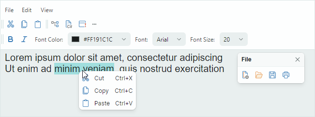

# Toolbars and Menus

The `ToolbarManager` component allows you to create traditional toolbars and menus, as well as the Ribbon UI. It offers rich capabilities to arrange and manage toolbars, create context menus, adjust toolbar view and behavior settings, and customize bars at runtime.

Item types: buttons, check buttons, editors, labels, sub-menus, and groups.

**User customization**

- Bar drag-and-drop - users can rearrange bars using drag handles.
- Customization mode and Customization Window - users can change the visibility of existing toolbars, create custom toolbars, and hide, restore, and move toolbar items with drag-and-drop.
- Quick customization - users can move items within and between bars by holding the Alt key, without activating customization mode.

**Layout options**

- Horizontal and vertical direction of individual bars
- Any position within a window
- Bar stretching
- Adaptive layout - toolbars automatically hide and restore items when the available space changes
- Options to show or hide bar drag handles and customization buttons

## Documentation

- [Toolbars and Menus](https://eremexcontrols.net/controls/toolbars-and-menus/)
