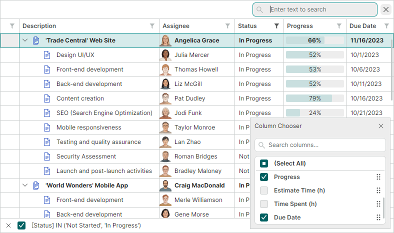
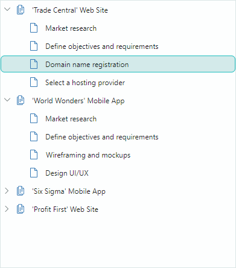

# TreeList and TreeView Controls

The library includes two data-aware controls to display hierarchical data in the form of a tree - `TreeListControl` and `TreeViewControl`. They render data source items as nodes (rows). If a node owns child nodes, you can expand it to display the next level of the hierarchy.

`TreeList` supports multiple columns:

`TreeView` is a single-column control:

The controls are derived from one ancestor, so they share multiple features:

- **Data Binding** - Bind the controls to self-referential (flat) and hierarchical data sources.
- **Unbound Mode** - Manually create the node structure.
- **Built-in Node Checkboxes** - Select individual nodes.
- **Data Sorting** - Sort sibling nodes in ascending or descending order; TreeList supports sorting against multiple columns.
- **Node Images** - Display custom images before cell values in the hierarchy column.
- **Styles** - Customize the appearance of the controls' elements in various states.
- **Search Panel** - Quickly locate nodes by the data they contain.
- **Data Edit Operations** - Embed Eremex and custom editors in cells to edit and present values.
- **Data Validation** - Check a user's input and show errors in cells.
- **Built-in and Custom Context Menus**
- **Data Annotation Attribute Support** - Control visibility, position, read-only state, and display name for auto-generated columns.
- **Node Drag-and-Drop** - Drag a node within the control and to another control.
- **High Performance for Large Volumes of Data** - Data virtualization for vertical and horizontal scrolling.

TreeList-specific features:

- **Unbound Columns** - Add columns that are not bound to data source fields and populate them manually.
- **Summaries** - Total summaries calculated across all rows.
- **Filtering** - Filter data with dropdown menus that display unique column values.
- **Auto Filter Row** - A special row that allows a user to filter data against columns.
- **Column Header Templates** - Display custom content in column headers, including images.
- **Multiple Node Selection** - Select (highlight) multiple nodes at once.
- **Column Bands** - Visually group multiple columns under a common header.
- **Fixed Columns** - Keep specific columns visible at the left or right edge while other columns scroll horizontally.
- **Best Fit** - Resize columns to the minimum width required to display their contents without truncation.
- **Column Resize and Move Operations**
- **Export to XLSX, PDF, CSV and Image Formats**

## Documentation

- [TreeList and TreeView](https://eremexcontrols.net/controls/treelist/)
